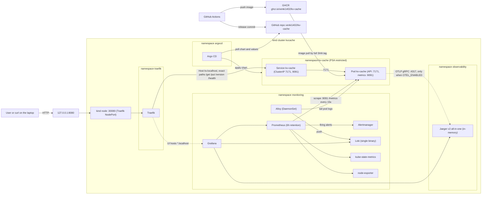
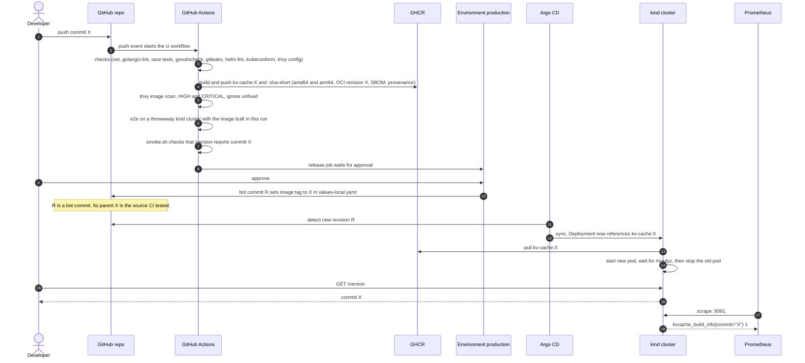

# Architecture

kv-cache is a Go (fasthttp) server holding a 32-shard in-memory LRU cache. It
runs as a single pod on a local kind cluster (`kvcache`: one control-plane node,
one worker, Kubernetes v1.37.0). Argo CD deploys it from this repo. The platform
around it (ingress, metrics, logs, traces, GitOps) is installed by
`make platform-up` with pinned chart versions. The reasoning behind each choice
is in [DECISIONS.md](DECISIONS.md).

## Components and request path

Notes:

- `make cluster-up` removes the control-plane `NoSchedule` taint, so workloads
  can run on either node and a drained worker has somewhere to reschedule to.
  Traffic enters on the control-plane's port 30080 and kube-proxy forwards it
  to the Traefik pod wherever it runs.
- The Ingress routes only four exact paths. `/metrics` (port 9091) and the
  probe paths `/healthz` and `/readyz` are not reachable through Traefik.
- NetworkPolicy denies all ingress in `kv-cache` by default. It then allows 7171
  from `traefik` and 9091 from `monitoring`. Egress is limited to DNS and, when
  tracing is on, `observability:4317`.
- Traefik also routes `grafana`, `prometheus`, `alertmanager`, `jaeger` and
  `argocd` `.localhost:8080` to their UIs. The diagram shows only the Grafana
  edge.
- In Grafana, the Loki data source extracts `trace_id` from the JSON log lines
  and links it to Jaeger. The Jaeger data source links back to Loki.

## Failure boundaries

| Component down | What breaks | What keeps working |
|---|---|---|
| kv-cache pod | Every API call through the ingress fails. A restart loses all cached keys and comes back cold. | Platform, dashboards and alerting. `KvCachePodNotReady`, `KvCachePodRestarting` and `KvCacheTargetDown` fire. |
| Traefik | All access from the laptop: the API on `kv.localhost` and every UI on `*.localhost:8080`. | The pod keeps serving in the cluster. Scraping, alerting, log and trace collection and Argo CD sync continue. `kubectl port-forward` still reaches everything. |
| Prometheus | Metrics collection and alert rule evaluation, so no alerts can fire. Grafana metric panels go empty. No persistent volume is configured, so a restart loses the 6h history. | The app, logs (Loki) and traces (Jaeger). |
| Alertmanager | Grouping and routing of alerts. | Prometheus still evaluates rules, and firing alerts show in the Prometheus UI. Locally alerts go to the default receiver anyway. |
| Grafana | Dashboards, Explore and the log-to-trace links. | All data collection. Prometheus, Alertmanager and Jaeger UIs are still reachable directly. |
| Loki or Alloy | Log search in Grafana. With Alloy down, new lines are not shipped. | The app (it only writes JSON to stdout). `kubectl logs` still works. Metrics and traces are unaffected. |
| Jaeger | Trace collection. The batch exporter drops spans it cannot send. Storage is in memory, so a restart loses all traces. | Requests: export is asynchronous and off the request path. `trace_id` still appears in logs, but the links lead nowhere. |
| Argo CD | New release commits are not applied, and manual drift is not reverted. | The running pod and everything already deployed. Git still holds the desired state for when Argo CD returns. |
| GHCR | Any new pod that needs an image not already on the node: a new release or a reschedule. With `maxUnavailable: 0` the old pod keeps serving and `KvCacheRolloutStuck` fires. CI cannot push. | The running pod. The image is cached on the node and `imagePullPolicy` is `IfNotPresent`. |
| GitHub Actions | No checks, image builds or releases. | The cluster, unchanged. Argo CD keeps the last synced state. |
| Worker node | Pods on the worker, including kv-cache if it is scheduled there. A single replica means a short outage while it reschedules, and the cache comes back empty. Loki's volume is node-local, so Loki stays Pending until the worker returns. | The control-plane node runs workloads too (its taint is removed), so kv-cache, Traefik and most of the platform reschedule there. |

## Commit to running pod

The same SHA X appears in five places: the image tag, the OCI
`org.opencontainers.image.revision` label, the `commit` field of `/version`, the
`app.kubernetes.io/commit` pod label and the `commit` label of
`kvcache_build_info`. Any one of them shows which source is running.

The release commit R does not trigger CI. Three things prevent it: its message
ends in `[skip ci]`, the workflow ignores pushes that only touch
`deploy/helm/kv-cache/values-local.yaml`, and pushes made with `GITHUB_TOKEN`
do not start workflows. R changes one line of values. The code it deploys is
the code tested at its parent X.

## Ports and hosts

| Address | Goes to | Reachable from |
|---|---|---|
| `127.0.0.1:8080` | kind control-plane `:30080`, the Traefik NodePort | Laptop only (bound to loopback) |
| `kv.localhost:8080` | Traefik, then Service `kv-cache:7171`, paths `/get` `/put` `/version` `/health` | Laptop |
| `grafana.localhost:8080` | Grafana | Laptop |
| `prometheus.localhost:8080` | Prometheus | Laptop |
| `alertmanager.localhost:8080` | Alertmanager | Laptop |
| `jaeger.localhost:8080` | Jaeger UI (`:16686`) | Laptop |
| `argocd.localhost:8080` | Argo CD server (plain HTTP) | Laptop |
| `kv-cache:7171` | App API and probes (`/healthz`, `/readyz`) | `traefik` namespace and kubelet |
| `kv-cache:9091` | `/metrics` | `monitoring` namespace |
| `jaeger.observability:4317` | Jaeger OTLP gRPC receiver | kv-cache pod when tracing is on |
| `loki.monitoring:3100` | Loki push and query API | Alloy and Grafana |
